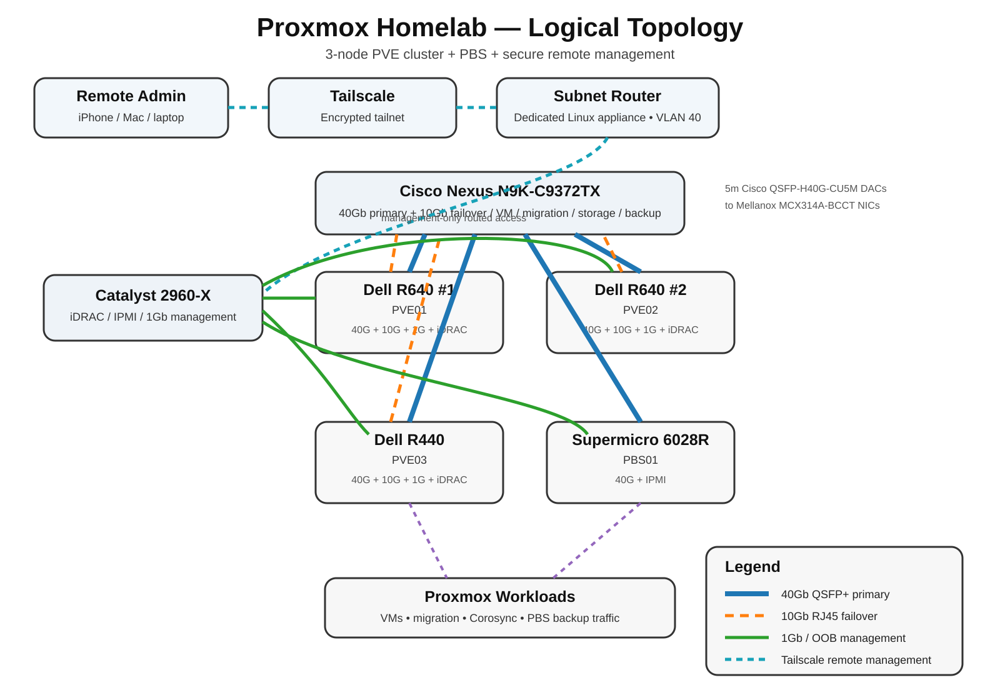

# Proxmox homelab logical topology

This diagram reflects the current planned homelab design:

- 3-node Proxmox VE cluster: 2 × Dell PowerEdge R640 + 1 × Dell PowerEdge R440
- Proxmox Backup Server: Supermicro 6028R-E1CR24N
- Cisco Nexus N9K-C9372TX for 40Gb primary and 10Gb failover/data traffic
- Cisco Catalyst 2960-X for iDRAC, IPMI, 1Gb management, and Tailscale subnet-router attachment
- Mellanox ConnectX-3 Pro MCX314A-BCCT 40Gb NICs
- Cisco QSFP-H40G-CU5M 5 m passive DAC cables
- Tailscale subnet-router capability for secure remote management from authorized devices anywhere
- Traditional VLAN underlay with Proxmox SDN/VXLAN overlay transport on VLAN 100

**As-built note (2026-11-01):** the cluster is two nodes today —
pve01 + pve02 (PVE 9.2, ZFS RAID1) — with a QDevice on the Lenovo
G550 (192.168.1.190) for quorum; pve03 and pbs01 are not installed
yet. Corosync runs on VLAN 20; the dedicated VLAN 21 ring below is
deferred. The Nexus 40Gb primaries (Eth1/49–50) have no transceivers
installed, so all server traffic rides the 10Gb failover ports
(Eth1/15–16). The firewall/router is a UniFi UCG-Fiber (UniFi OS
5.1.34 / Network 10.6.109; UniFi OS 6 / Network 11 not yet offered —
Network 11 requires OS 6, so the verdict is wait), and its firewall
policies are zone-based. A Lenovo-hosted local CA ("Homelab CA")
fronts the fleet's web UIs through the NPM reverse proxy on VLAN 41.

**Update (2026-11-03):** after the firmware windows, placement
settled with no failback — pve02 carries CT 200–203 and VMs 300, 302,
304, 305, 306, 308, 309; pve01 carries CT 204 and VMs 301, 303, 307.
The HA set is ct:200, ct:201, vm:302, vm:306, vm:309, each with a
*/15 replication job (200-0, 201-0, 302-0, 306-0, 309-0). AdGuard
holds 17 DNS rewrites: 13 names to NPM (10.10.41.11), the iDRAC pair
direct to 10.10.10.11/.12, and livenx/livepca direct to their apps.

**Update (2026-11-03, evening):** three more containers on pve02 —
CT 205 `tacacs-01` (10.10.41.15, TACACS+ server; Ubuntu 24.04, the
fleet's only non-Debian guest), CT 206 `paperless-01` (10.10.41.16,
Paperless-ngx), CT 207 `scrutiny-01` (10.10.41.17, Scrutiny hub;
collectors run on both PVE hosts). AdGuard now holds 20 rewrites
(16 to NPM). What's Up Docker image-update monitoring runs as a
container on docker-01 (VM 301), watching all seven fleet Docker
hosts through read-only socket-proxy sidecars.

**Update (2026-11-04, afternoon):** LivePCA (VM 303) moved off DHCP
to its fleet-pattern static address — 10.10.41.24 (gateway
10.10.41.1, DNS 10.10.41.10), set in the LiveWire UI; the old DHCP
address 10.10.41.129 is retired. The follow-through landed the same
day: the AdGuard rewrite for `livepca.homelab` was repointed to .24
(config backed up first), the Uptime Kuma LivePCA monitor was
retargeted, and Scanopy's host entry was repointed (.129 → .24)
with its previously blank name set to `livepca-01`. The appliance's
Homelab CA certificate still lists .129 as an IP SAN — cosmetic
only, since all access is by name.



## VLAN map

| VLAN | Role | Network intent |
|---:|---|---|
| 10 | OOB / iDRAC / IPMI / switch management | Restricted management only |
| 20 | PVE management | GUI, API and SSH management |
| 21 | Corosync | Cluster membership/quorum; low latency; pure L2 on Nexus — no gateway, no Tailscale route |
| 30 | PBS management | PBS GUI/API/SSH |
| 31 | PBS backup/restore | Primary PVE↔PBS backup path over 40Gb; no Tailscale route |
| 40 | Tailscale / infra mgmt | Tailscale subnet routers, UPS, PDU management |
| 41 | Infrastructure services | DNS, reverse proxy, monitoring, automation, Docker host |
| 100 | Proxmox SDN / VXLAN transport | Physical underlay for overlay VNets |
| 998 | Blackhole/native | Unused ports/native safety VLAN |

## Link roles

- **40Gb QSFP+** — primary high-speed server connectivity for VM traffic, migration, storage, and PBS backup/restore traffic.
- **10Gb RJ45** — secondary/failover data path on the Dell Proxmox nodes.
- **1Gb / OOB** — Catalyst 2960-X path for iDRAC, IPMI, PVE management fallback, infrastructure management, and Tailscale subnet routers.
- **Tailscale remote management** — encrypted remote access through a dedicated subnet router; no Proxmox, PBS, iDRAC/IPMI, or switch-management service is exposed directly to the Internet.

## Remote-management path

```text
Authorized remote device
(iPhone / Mac / laptop)
          |
      Tailscale
          |
Dedicated subnet router
       VLAN 40
          |
  Firewall / routed policy
          |
   +------+------+----------------+
   |             |                |
VLAN 10       VLAN 20          VLAN 30
OOB/BMC       PVE mgmt         PBS mgmt
   |             |                |
iDRAC/IPMI   PVE GUI/SSH      PBS GUI/SSH
Switch mgmt
```

The Catalyst 2960-X remains Layer 2. The firewall/router owns the gateways and routes between VLANs 10, 20, 30, and 40. The switch itself uses a VLAN 10 management SVI and an `ip default-gateway` toward the firewall/router.

Advertise only the management prefixes needed for administration. Do **not** advertise VLAN 21 Corosync or VLAN 31 PBS backup through Tailscale.

## SDN model

Use traditional VLANs as the physical underlay. Keep management, Corosync, and PBS backup on normal VLANs. Use VLAN 100 as the Proxmox SDN/VXLAN transport so overlay VNets can span PVE01, PVE02, and PVE03 without creating a new physical VLAN for every test network.

See [../network/PORT-MAP.md](../network/PORT-MAP.md), [../network/nexus9k.example.cfg](../network/nexus9k.example.cfg), and [../network/catalyst2960x-oob.example.cfg](../network/catalyst2960x-oob.example.cfg) for the matching switch design.

See [../remote-access/README.md](../remote-access/README.md) for the Tailscale deployment, ACL/grant guidance, and WireGuard alternatives.

See also [RACK-LAYOUT.md](./RACK-LAYOUT.md) for the physical front/rear rack layout and cable-routing plan.
